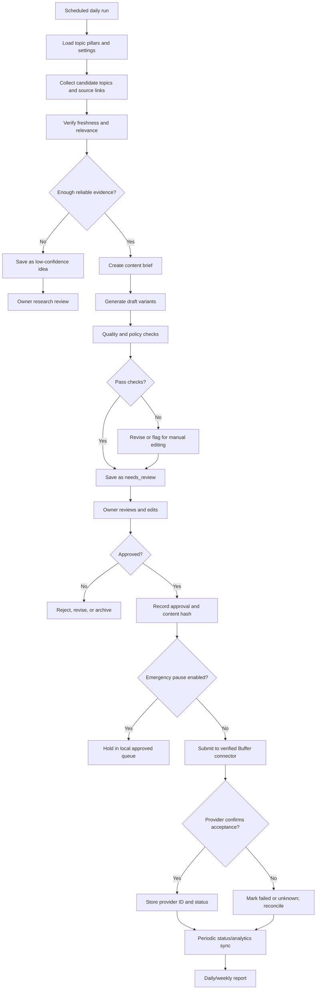

# Workflow Specification
## XGrowth AI — Research → Draft → Approval → Buffer → Analytics

## 1. Daily workflow



## 2. Research workflow

1. Load configured topic pillars and source allowlist.
2. Gather candidate items from approved search/news/RSS sources.
3. Save source URL, publisher, publication time, retrieval time, and relevant excerpt/summary.
4. Score relevance, freshness, credibility, and usefulness.
5. Exclude unsupported claims, duplicate topics, and irrelevant trends.
6. Produce a short research brief with fact/opinion separation.
7. If evidence is weak, label the idea `needs_source_review`; do not fabricate supporting facts.

## 3. Draft-generation workflow

For each approved brief:
1. Select a format: single post, educational tip, opinion, project update, or thread draft.
2. Use the configured voice guide and audience.
3. Generate up to three variants only when useful.
4. Validate current character limits and formatting constraints.
5. Check for duplicate or near-duplicate content.
6. Check factual statements against source material.
7. Flag sensitive, speculative, promotional, or potentially misleading claims.
8. Save as `needs_review`.

## 4. Approval workflow

- Draft preview shows text, format, source links, character count, quality notes, and risk flags.
- Owner may edit, approve, reject, or request regeneration.
- Approval is bound to a hash of the exact text and target channel.
- Any text/channel change after approval resets state to `needs_review`.
- Store approver and timestamp.

## 5. Buffer submission workflow

1. Check emergency pause.
2. Confirm content state is `approved`.
3. Confirm approval hash matches current content.
4. Confirm target Buffer channel is connected and enabled.
5. Confirm integration token is valid.
6. Check local duplicate key/provider history.
7. Call only the verified documented Buffer endpoint.
8. Persist request correlation ID and provider response.
9. If confirmed, mark `submitted_to_buffer` and store provider ID.
10. If rejected, store sanitized error and mark `failed`.
11. If timeout/ambiguous response, mark `unknown`; reconcile with Buffer before retry.
12. Never claim queued/scheduled/published without provider confirmation.

## 6. Status model

```text
idea
  -> researched
  -> draft
  -> needs_review
  -> approved
  -> submitted_to_buffer
  -> queued
  -> published

Alternative terminal/holding states:
rejected | archived | failed | unknown | needs_source_review | paused
```

Use `queued` and `published` only when confirmed by Buffer or a trusted connected source. If the API cannot provide a state, display `submitted; status unavailable`.

## 7. Retry policy

- Retry only clearly transient failures (e.g. documented rate-limit response after its reset time, temporary server errors).
- Use exponential backoff with jitter and a bounded attempt count.
- Do not blindly retry timeouts or network disconnects after request submission; mark `unknown` and reconcile first.
- Do not retry authentication, permission, validation, or unsupported-channel errors without corrective action.
- Never retry a non-idempotent create request until duplicate risk has been resolved.

## 8. Analytics workflow

1. Fetch metrics only from documented, authorized sources.
2. Record source, provider object ID, metric timestamp, and fetch timestamp.
3. Normalize units without inventing missing data.
4. Calculate derived metrics only with documented formulas.
5. Label small-sample results as directional.
6. Generate weekly insights: strongest themes, format comparisons, consistency, and experiments.
7. Recommend next week's content tests; do not promise follower growth.

## 9. Human engagement workflow

1. Identify a relevant conversation from an authorized data source.
2. Summarize why it is relevant.
3. Draft a contextual reply.
4. Present source/context and draft to owner.
5. Owner manually posts the reply, unless a future, explicitly authorized, policy-compliant workflow is verified.
6. Never automate mass replies, unsolicited replies, likes, follows, or repetitive engagement.

## 10. Emergency stop

A single global `PAUSED` switch must block:
- Buffer submissions
- Automated queue changes
- Any future external engagement action

Research and local draft generation may continue if configured. The dashboard must clearly show pause state and last successful external action.
