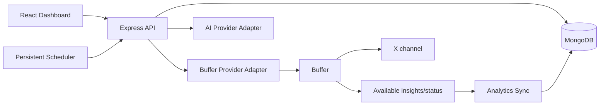

# Architecture

## Principles
- Buffer is the publishing system of record for outbound X posts.
- The app owns ideas, research, drafts, approval records, audit events, and analytics normalization.
- A provider adapter isolates Buffer-specific details.
- AI generation is a replaceable service, not coupled to the UI.
- External writes are approval-gated and globally pausable.

## Logical components



## Backend modules
- `auth`: owner authentication and sessions
- `settings`: brand voice, topics, schedule, provider settings
- `research`: source ingestion and topic scoring
- `content`: drafts, variants, validation, deduplication
- `approvals`: immutable approval records and content hashes
- `providers/buffer`: server-side personal API key, channels, submission, status sync
- `analytics`: normalized snapshots and reports
- `scheduler`: persistent jobs and run history
- `audit`: security and external-action records
- `health`: readiness and provider health checks

## Suggested repository layout

```text
xgrowth-ai/
  apps/
    web/
    api/
  packages/
    shared/
    config/
  docs/
  config/
  schemas/
  templates/
  scripts/
  tests/
  .env.example
  AGENTS.md
  PRD.md
  WORKFLOW.md
  PROMPT.md
  README.md
```

## Provider interfaces

Create a typed interface before implementation. Example conceptual operations:
- `getConnectionStatus()`
- `listOrganizations()` (only if documented)
- `listChannels()` (only if documented)
- `submitApprovedPost(input)` (only if documented)
- `getSubmissionStatus(id)` (only if documented)
- `getPostAnalytics(id, range)` (only if documented)

These are internal interface names, not claims about Buffer endpoint names. The adapter must map them to verified documented operations or return a typed `UnsupportedCapability` result.

## Data flow
1. Research items become topic briefs.
2. Topic briefs become content drafts.
3. Drafts pass deterministic and AI-assisted checks.
4. Owner approves an exact content snapshot.
5. Submission service checks pause, approval hash, target channel, and duplicate key.
6. Buffer adapter submits the item.
7. Provider response is stored.
8. Status sync updates only what the provider confirms.
9. Analytics snapshots feed reports.

## Reliability
- Use persistent job records, not only in-memory timers.
- Use unique indexes for local duplicate keys.
- Store provider request IDs and response IDs.
- Keep `unknown` separate from `failed`.
- Use bounded retry with backoff only for known-safe transient failures.

## Buffer API constraints
For a single-owner deployment, prefer a personal Buffer API key stored only on the server. Buffer's current API is GraphQL at `https://api.buffer.com`. Full Insights analytics and comment/reply management are not reliable API capabilities today; do not promise them in the MVP. Use Buffer's dashboard for full native Insights and engagement workflows, while this app focuses on research, drafting, approvals, queue submission, and publishing-history retrieval.
